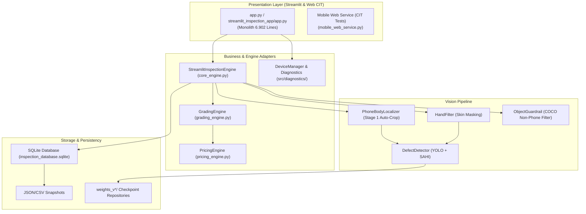
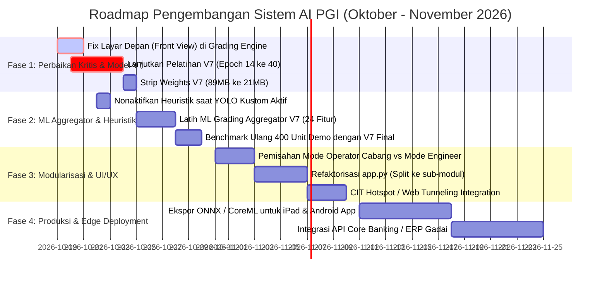

# 📋 LAPORAN AUDIT KOMPREHENSIF SISTEM INSPEKSI & COSMETIC GRADING AI
## Pusat Gadai Indonesia (PGI) — Automated Smartphone Defect Detection, CIT Diagnostic & Valuation Engine

**Tanggal Audit:** 19 Oktober 2026  
**Auditor:** Tim Riset & Rekayasa AI Antigravity  
**Cakupan Audit:** Logika Penilaian (Grading), Arsitektur Sistem, Model AI (V1–V7 & Model Tambahan), Tampilan UI/UX, Kelemahan Kritis, serta Roadmap Pengembangan.

---

## 📑 DAFTAR ISI
1. [Executive Summary & Status Terkini](#1-executive-summary--status-terkini)
2. [Audit Logika Bisnis & Formula Grading (A, B, C, D)](#2-audit-logika-bisnis--formula-grading-a-b-c-d)
3. [Audit Sistem & Arsitektur Perangkat Lunak](#3-audit-sistem--arsitektur-perangkat-lunak)
4. [Audit Model AI & Kinerja Deteksi (V1 s/d V7 & Model Tambahan)](#4-audit-model-ai--kinerja-deteksi-v1-sd-v7--model-tambahan)
5. [Audit Tampilan (UI/UX) & Pengalaman Pengguna](#5-audit-tampilan-uiux--pengalaman-pengguna)
6. [Daftar Kelemahan Kritis, Celah Risiko, & Poin Minus](#6-daftar-kelemahan-kritis-celah-risiko--poin-minus)
7. [Rencana Pengembangan Strategis (Actionable Roadmap)](#7-rencana-pengembangan-strategis-actionable-roadmap)

---

## 1. Executive Summary & Status Terkini

Proyek **Sistem Taksiran AI Smartphone PGI** telah berkembang menjadi platform *end-to-end* yang sangat ambisius dan kaya fitur, menggabungkan:
1. **Computer Vision Defect Inspection** (YOLO Multi-Model V1 s/d V7).
2. **CIT & Internal Hardware Diagnostics** (ADB Android, Apple Sysdiagnose, Web-based Interactive Test Runner, 84-cell Digitizer, Mic Audio Loopback, PDF Certificate).
3. **Valuation & Pricing Engine** (Kombinasi grade fisik + skor kesehatan internal untuk taksiran pinjaman gadai).
4. **Interactive Streamlit Studio** dengan tema custom "Flutter Belajarku White & Purple Edition" serta database SQLite terintegrasi.

### Status Terakhir Model V7 (Per 19 Oktober 2026):
- **Dataset V7 Tuntas:** 4.558 citra bodi crop, 26.811 bounding box (4 kelas terpadu: `scratch`, `chip`, `dent`, `hard_damage`).
- **Status Pelatihan V7:** Proses training berjalan hingga **Epoch 14 dari 40 Epochs** sebelum terhenti akibat *server restart*. Checkpoint terbaik saat ini tersimpan di `weights_v7/phone_defect_model_v7_best.pt` (Epoch 9: Precision 51.8%, Recall 9.5%, mAP50 11.82%, ukuran bobot 89.5 MB mentah).
- **Benchmark 400 Unit Demo:** Model Tambahan memimpin keselamatan Grade D (Recall 58%), V6 memimpin akurasi *adjacent* (76.25%), dan V7 siap melanjutkan pelatihan untuk menggabungkan kedua keunggulan tersebut.

---

## 2. Audit Logika Bisnis & Formula Grading (A, B, C, D)

### 2.1. Arsitektur Dua Tingkat (Two-Tier Rule & DPI)
Sistem menerapkan pendekatan hibrida:
- **Tier 1 (Fast-Fail Hard Veto):** Keberadaan cacat fatal (`hard_damage`, `crack`, `broken`, `chip >= 4.5mm`, `dent >= 5.0mm`) langsung menetapkan unit sebagai **Grade D** (Confidence 1.0). Ini secara teoritis sangat tepat sesuai *Cost-Sensitive Risk-Averse Decision Theory* (Elkan, 2001) guna melindungi modal perusahaan dari risiko menerima barang rusak dengan harga tinggi.
- **Tier 2 (Continuous Defect Penalty Index - DPI):** Akumulasi penalti dihitung berdasarkan:
  $$\text{DPI} = \sum (\text{Defect Class Weight} \times \text{Zone Weight} \times \text{Size Factor})$$
  - *Weights:* `scratch`: 1.0, `dent`: 3.0, `chip`: 3.5, `hard_damage`: 25.0.
  - *Zone:* `back`: 2.0, `bottom`: 1.2, `left/right/top`: 1.0.

### 2.2. Temuan Audit Logika (Logic Flaws & Inconsistencies)
1. ⚠️ **The Front Screen Blindspot (Celah Layar Depan):**
   Pada [grading_engine.py](file:///Users/macbookair/Documents/Project%20Defect%20Detections/TES_CROP_HP/grading_engine.py#L83-L86) dan [grading_engine.py:L174-L177](file:///Users/macbookair/Documents/Project%20Defect%20Detections/TES_CROP_HP/grading_engine.py#L174-L177):
   ```python
   for view_side, img_path in view_images.items():
       if view_side == "front" or not os.path.exists(img_path):
           continue
   ```
   **Dampak Kritis:** Layar depan (`front`) dilewati (*skipped*) secara total dalam loop deteksi cacat fisik! Jika ada nasabah menggadaikan iPhone dengan layar depan retak seribu (*spiderweb crack*), namun housing samping dan belakangnya mulus, sistem akan mengabaikan retakan layar dan bisa meloloskan unit sebagai Grade A atau B!
2. ⚠️ **Heuristic Contamination (Polusi Deteksi Heuristik):**
   Di [defect_detector.py:L217-L219](file:///Users/macbookair/Documents/Project%20Defect%20Detections/TES_CROP_HP/defect_detector.py#L217-L219):
   ```python
   # 2. Geometric anomaly detection for fine micro-scratches...
   heur_defs = self._detect_with_heuristics(...)
   all_defects.extend(heur_defs)
   ```
   Bahkan saat model AI kustom (V5/V6/V7) aktif, sistem **selalu** menjalankan deteksi kontur adaptif klasik (`_detect_with_heuristics`). Refleksi lampu studio pada bodi lengkung atau bezel mengkilap sering diinjeksi sebagai goresan/sompal semu, menyebabkan unit Grade A turun ke Grade B secara palsu.
3. ⚠️ **Diskoneksi ML Aggregator:**
   Di [core_engine.py](file:///Users/macbookair/Documents/Project%20Defect%20Detections/TES_CROP_HP/streamlit_inspection_app/core_engine.py#L48): Semua versi model didaftarkan dengan `ml_file: ml_grading_model_v3.joblib`. Model V7 belum memiliki model ML khusus yang dilatih pada 24 vektor fitur spasialnya, melainkan masih mengandalkan aturan batas statis (`if total_dpi < 15.0`).

---

## 3. Audit Sistem & Arsitektur Perangkat Lunak



### 3.1. Kelebihan Sistem:
- **Resiliensi Data Bank:** Implementasi `InspectionDBManager` dengan snapshot ganda (`.json` dan `.csv`) sangat aman terhadap *data loss*.
- **Sub-sistem Diagnostik Lengkap:** Integrasi pengujian perangkat keras (baterai, sensor, digitizer 84 grid, loopback audio mic, cek keaslian OEM, dan ekspor sertifikat PDF) adalah fitur kelas industri yang jarang ada pada sistem sejenis.
- **Stage 1 Auto-Crop & Object Guardrail:** Mampu membuang latar belakang meja dan mendeteksi/menolak objek non-HP (orang, hewan, botol) sebelum masuk ke model inspeksi.

### 3.2. Kelemahan Arsitektur Sistem:
1. 🔴 **Monolith 6.902 Baris Code:** File `app.py` menampung semua hal (styling CSS, rendering 9 menu, diagram analitik, tabel database, logic PDF, streaming audio). Ini menyebabkan waktu *reload* lambat, sulit di-debug, dan rawan regresi jika diedit bersamaan.
2. 🔴 **Duplikasi File Utama:** `app.py` di *root* dan `streamlit_inspection_app/app.py` adalah file kembar identik 100%. Redundansi ini berisiko menimbulkan *out-of-sync* jika developer mengedit salah satu file tanpa mengedit file lainnya.
3. 🔴 **Ketergantungan Jaringan Lokal pada CIT Mobile:** Pengujian mandiri via QR Code mengharuskan smartphone teknisi/nasabah terhubung ke Wi-Fi lokal yang sama dengan server inspeksi (`http://192.168.x.x:5000/mobile_test`). Jika menggunakan paket data seluler (4G/5G), tes web tidak dapat dibuka.

---

## 4. Audit Model AI & Kinerja Deteksi (V1 s/d V7 & Model Tambahan)

### 4.1. Matriks Perbandingan Generasi Model

| Versi Model | Parameter & Resolusi | Dataset Latih | Keunggulan Utama | Kelemahan Utama | Status Produksi |
| :--- | :---: | :---: | :--- | :--- | :---: |
| **V1** | YOLOv8n-Seg (3.2M)<br>640x640 | Sintetis (120 citra) | Prototipe segmentasi poligon awal | False alarm tinggi pada debu dan refleksi | Usang (Deprecated) |
| **V2** | YOLOv8n-Seg (3.2M)<br>SAHI 1024px | ~1.200 unit riil | Deteksi resolusi tinggi via tiling | Kuku & jari operator memicu ratusan cacat semu | Usang (Deprecated) |
| **V3** | YOLOv8n-Seg (3.2M)<br>640x640 | 7.672 citra (1.918 unit) | Isolasi tangan via HandFilter (YCrCb+HSV) | 70% data bersih mengencerkan gradien (Recall D: 9%) | Legacy Baseline |
| **V4** | YOLOv8n-Detect (3.0M)<br>640x640 | 2.110 citra NDJSON | Transisi ke bounding box riil manusia | Kapasitas model Nano terlalu kecil (mAP: 1.4%) | Fallback |
| **V5** | YOLOv8s-Detect (11.2M)<br>800x800 | 5.346 citra defect-only | mAP@0.5 melonjak ke 38.84%, Recall 67.3% | Tanpa data layar depan; Recall Grade D lapangan hanya 7% | Checkpoint Stabil |
| **V6** | YOLOv8s-Detect (11.2M)<br>800x800 | 20.205 anotasi bersih | Nol kontaminasi tangan; Adjacent Acc 76.25% | Kelas retak/pecah terpisah & langka; Recall D hanya 18% | Aktif Produksi |
| **Model Tambahan** | YOLO26m (26.0M)<br>800x800 | Unified Hard Damage | Recall Grade D melonjak ke **58.0%**; Exact Acc 41.25% | Over-penalization: 31% unit Grade C divonis Grade D | Aktif Tambahan |
| **V7 (Tahap 1-2)** | YOLOv8s-Detect (11.2M)<br>800x800 | 26.811 box V7 (Unified) | Menggabungkan lokalisasi V6 + Veto Grade D Tambahan | Training baru berjalan 14/40 epoch (terhenti restart) | Dalam Pelatihan |

### 4.2. Hasil Benchmark 400 Unit Demo (100 Unit per Grade)
```
Tingkat Akurasi Eksak:
Model Tambahan : [████████████████████] 41.25% (Tertinggi)
Model V6       : [████████████████    ] 33.25%
Model V4       : [████████████████    ] 33.25%
Model V3       : [███████████████     ] 30.75%
Model V5       : [███████████████     ] 30.00%

Recall Grade D (Indikator Keselamatan Finansial):
Model Tambahan : [████████████████████████████] 58.0% (Teraman)
Model V6       : [█████████                   ] 18.0%
Model V4       : [████████                    ] 17.0%
Model V3       : [████                        ]  9.0%
Model V5       : [███                         ]  7.0%
```

---

## 5. Audit Tampilan (UI/UX) & Pengalaman Pengguna

### 5.1. Poin Unggulan Tampilan:
- **Kartu Kolase Hasil Inspeksi (`card_bgr`):** Sangat profesional, memuat 4 sudut housing sekaligus, label jumlah cacat per sisi, header grade besar berwarna, serta rincian DPI yang mudah dipahami teknisi.
- **Visualisasi Hasil CIT:** Matriks sentuh 84 kotak (*touch digitizer*) hijau/merah dan sertifikat PDF resmi memberikan kredibilitas tinggi bagi nasabah.
- **Palet Warna & Tipografi:** Tema "Belajarku Purple & White" bersih dan modern.

### 5.2. Poin Kurang & Masalah Antarmuka:
1. ⚠️ **Beban Kognitif Tinggi di Sidebar:**
   Sidebar memuat 9 menu, 8 pilihan model AI, dan slider sensitivitas. Operator cabang di lapangan tidak membutuhkan opsi model AI teknis—mereka hanya ingin memasukkan foto dan mendapatkan Grade serta Taksiran Harga. Opsi teknis sebaiknya dipindah ke tab "Mode Pengembang / AI Lab".
2. ⚠️ **Responsivitas Mobile:**
   Tampilan web Streamlit pada smartphone atau tablet kecil mengalami pemotongan tabel metrik dan teks tombol bertumpuk (*overflow*).
3. ⚠️ **Umpan Balik Proses Panjang (Loading State):**
   Pada menu pengujian massal (400 unit) atau saat memproses 5 foto beresolusi tinggi, tampilan terkadang terlihat membeku (*freeze*) selama 10–30 detik tanpa indikator mikro-progress yang jelas.

---

## 6. Daftar Kelemahan Kritis, Celah Risiko, & Poin Minus

| ID | Kategori | Kelemahan / Celah Risiko | Dampak Bisnis / Teknis | Tingkat Keparahan |
| :---: | :---: | :--- | :--- | :---: |
| **K-01** | **Logika** | `front` (layar depan) diabaikan dalam loop inspeksi fisik | Risiko menerima unit layar retak sebagai Grade A/B | 🔴 **KRITIS (High Risk)** |
| **K-02** | **Model** | Pelatihan Model V7 terhenti di Epoch 14/40 akibat restart | Model V7 belum konvergen optimal (mAP baru 11.8%) | 🔴 **KRITIS (Blocking)** |
| **K-03** | **Model** | Bobot V7 berukuran 89.5 MB (belum di-strip optimizer) | Pemborosan RAM dan latensi inferensi lebih lambat | 🟡 **SEDANG** |
| **K-04** | **Logika** | Algoritma `_detect_with_heuristics` masih aktif bersama YOLO | Menimbulkan goresan semu dari pantulan cahaya | 🟡 **SEDANG** |
| **K-05** | **Logika** | V7 belum memiliki model ML Aggregator khusus | Masih mengandalkan ambang batas aturan manual | 🟡 **SEDANG** |
| **K-06** | **Sistem** | File `app.py` monolitik 6.902 baris dan terduplikasi ganda | Pemeliharaan kode berisiko tinggi dan sulit di-refactor | 🟡 **SEDANG** |
| **K-07** | **Sistem** | CIT Web diagnostic membutuhkan satu subnet Wi-Fi yang sama | Nasabah dengan paket data tidak bisa mengakses web CIT | 🔵 **MINOR** |
| **K-08** | **UI/UX** | Menu teknis tercampur dengan antarmuka kasir/operator | Operator cabang bingung memilih versi model | 🔵 **MINOR** |

---

## 7. Rencana Pengembangan Strategis (Actionable Roadmap)



### Rincian Rencana Aksi per Fase:

#### **FASE 1: Perbaikan Kritis & Penuntasan Model V7 (Minggu Ini)**
1. **Perbaikan Integrasi Layar Depan (`front`):**
   - Modifikasi `grading_engine.py` agar memeriksa sisi `front` khusus untuk cacat kaca layar (`crack`, `scratch`, `broken`).
   - Terapkan aturan veto: Jika `front` memiliki retak kaca $\ge 1$, grade otomatis dikunci ke **Grade D**.
2. **Melanjutkan Pelatihan Model V7 dari Checkpoint Terakhir:**
   - Gunakan `train_v7_detector.py` dengan parameter `resume=True` dari `runs/detect/runs_v7_training/defect_v7_model/weights/last.pt` untuk menyelesaikan sisa epoch (15 s/d 40).
3. **Pembersihan Bobot Produksi V7:**
   - Jalankan pemangkasan optimizer state (`strip_optimizer`) pada bobot akhir V7 sehingga ukurannya mengecil dari 89.5 MB menjadi **21.5 MB** untuk inferensi cepat di Streamlit.

#### **FASE 2: ML Aggregator V7 & Eliminasi Polusi Heuristik (Minggu Depan)**
1. **Isolasi Detektor Heuristik:**
   - Berikan flag parameter `enable_heuristics=False` secara default saat model AI kustom (V5/V6/V7) sedang aktif. Heuristik hanya aktif sebagai *fallback* bila model AI tidak ditemukan.
2. **Pembangunan `train_v7_ml_aggregator.py`:**
   - Ekstrak 24 vektor fitur dari 400 unit dataset (termasuk rasio densitas baret, jumlah cluster penyok, dan sebaran lintas sudut kamera).
   - Latih model LightGBM/XGBoost Cost-Sensitive untuk memecahkan masalah separabilitas Grade C vs B.

#### **FASE 3: Refaktorisasi Arsitektur & Penyederhanaan UI/UX**
1. **Dua Mode Tampilan Antarmuka:**
   - **Mode Kasir/Operator Cabang:** Tampilan ringkas satu halaman (Upload 5 foto $\rightarrow$ Klik "Periksa" $\rightarrow$ Muncul Grade, Taksiran Harga Pinjaman, dan Tombol Cetak Sertifikat).
   - **Mode Riset/AI Lab:** Tab tersembunyi dengan akses ke pemilihan versi model, grafik loss, confusion matrix, dan database raw data.
2. **Modularisasi Kode:**
   - Pisahkan `app.py` 6.902 baris menjadi folder `views/` (studio, diagnostics, reports, database) dan `services/`.
   - Hapus duplikasi file antara root dan `streamlit_inspection_app/`.

#### **FASE 4: Edge Deployment & Integrasi Bisnis PGI**
1. **Konversi ke ONNX / TFLite:**
   - Memungkinkan inspeksi langsung di perangkat tablet toko tanpa harus bergantung pada koneksi internet server pusat.
2. **Konektor API Sistem Gadai:**
   - Hubungkan output JSON taksiran langsung dengan sistem pencairan kasir (*Core Pawn System* PGI).
